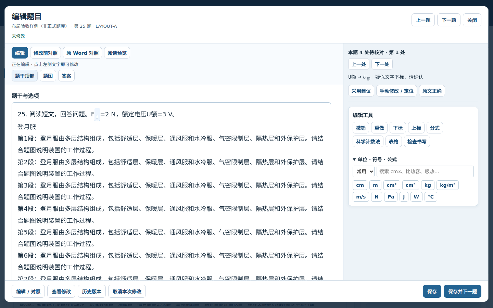
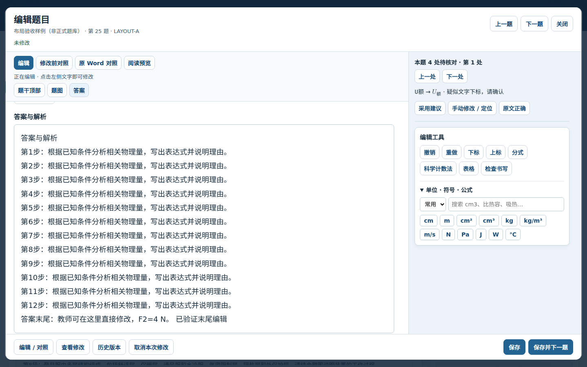

# 题库编辑器第一阶段：左侧编辑、右侧操作

范围：仅 `zmdyy/xqfx-zsxq-tk` 的 `question-bank/` 编辑器。第一阶段不改题库内容，不改审核路由、疑点识别规则、批量修改或 Word 排版。

## 完成的行为

- 默认左侧直接编辑题干、选项、题图、答案及小问；右侧显示疑点操作和公式、单位工具。桌面布局约为 70% / 30%，窄屏改为上下区域。
- 移除编辑正文对全站 `main` 布局的继承，正文和操作区域分别获得确定的可用高度和独立滚动。
- 题目信息、正文视图切换与定位按钮、底部保存按钮保持可见。编辑器打开时锁定背景网页滚动，关闭后恢复。
- 左侧可切换“修改前对照”和“原 Word 提取内容”，明确显示只读状态；返回编辑恢复原滚动位置，不另外占一栏。
- 阅读预览明确提供“返回编辑”，只读时禁止修改工具和采用操作。
- 题干顶部、题图、答案及疑点定位只滚动正文区域；定位焦点不再带动外层页面。
- 右侧工具点击保留左侧文本选区；没有有效选区时使用当前编辑字段，而不是总插入题干。
- 上一题、下一题、保存并下一题清理旧选区和公式目标，回到新题顶部，工具仍可操作。
- 更新编辑器 JS/CSS 的资源版本为 `20261013layout1`。

## 验证结果

通过 `npm test`；以下三个浏览器检查也已通过：

1. `question-bank-teacher-editor.test.cjs`：公式、单位、表格往返，草稿重开，历史恢复，并发保护，新题，ZIP备份恢复及窄屏对照。
2. `question-bank-editor-layout-browser.test.cjs`：实际鼠标滚轮分别滚动两栏，背景不移动；长题答案末尾键盘编辑；对照返回原位置；选中字母后的数字后点击右侧下标，公式仍插入原选区；阅读/编辑切换；保存并切题复位；1920×1080、1366×768、390×844布局边界。
3. `question-bank-review-browser.test.cjs`：审核疑点选择、重复题决定持久化、题库版本更新和教师内容保护。

浏览器检查使用 Chromium headless shell，测试过程中无页面 JS 异常。截图来自专门的布局验收样例，**不是用户正式题库**。

## 后续阶段

以下尚未实施，不列为本阶段已完成：准确字符偏移定位与持续高亮、一键同类修改、上下标及撇号识别扩展、连续双栏预览、原生 Word 分栏、超出 A4 仍可导出、`#review` 全窗口审核与历史导航。

当前疑点仍沿用原有识别与匹配规则；第一阶段仅约束其滚动范围并保留操作区。下一阶段处理重复符号定位不一致、修改反馈和批量处理。
