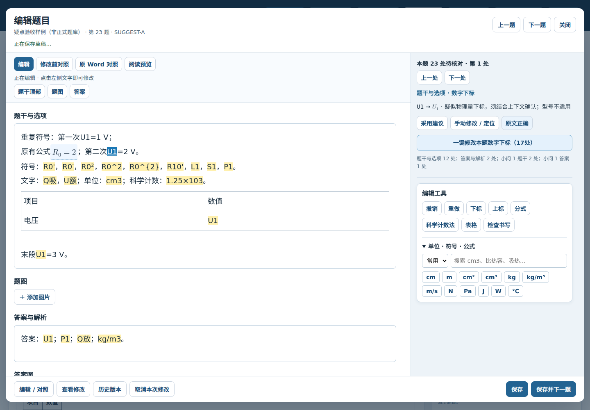
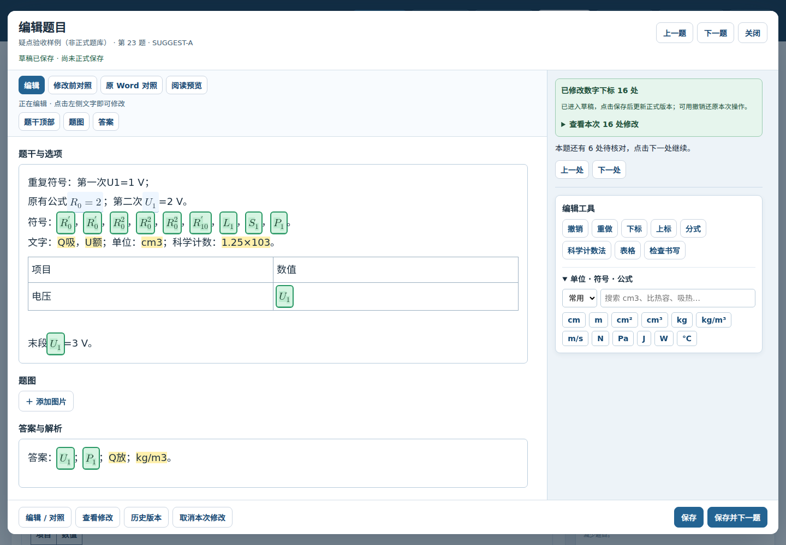

# 题库编辑器第二阶段：准确定位、持续高亮和一键同类修改

范围仅限 `zmdyy/xqfx-zsxq-tk`。沿用第一阶段的左侧编辑、右侧操作布局；本阶段不改 Word 分栏、A4 导出限制或 `#review` 路由。

## 已完成

- 保存正文与定位共用同一个序列化位置映射，覆盖普通文本、公式前后、换行、跨文本节点和表格单元格。多个相同 `U1` 不再总定位到第一次出现。
- 初次打开高亮并显示第一处疑点；右侧说明其位于题干、答案或哪一独立小问。
- 当前疑点蓝色，其他待核对位置浅黄色；高亮不会因为点击右侧按钮而消失。使用 CSS Highlight 显示层，不往正文插入高亮标签。
- 采用建议后在原位置显示修改结果，短暂标绿约6秒；右侧保留修改前后与修改数量，直到用户点击上一处/下一处继续。可从本次修改清单重新定位结果。
- “一键修改本题同类问题（N处）”一次应用当前类别在题干、答案和独立小问中的全部建议，无第二次确认。右侧列出各区域数量。
- 类别包含数字下标、文字下标、单位指数、比热容单位格式和科学计数法。只应用扫描规则已提出的建议，不自动判定物理内容正确。
- 批量操作作为一次撤销/重做操作；结果先保存草稿，保存后才更新正式版本。右侧会区分草稿与正式保存状态。
- 已确认“原文正确”的位置不参与批量操作；其他自动修改导致字符位置移动时，相应确认记录同步更新。
- 数字下标覆盖常见符号及一至两位数字，并区分数字下标与撇号/既有上标。例如 `R0' → R₀′`、`R0² → R₀²`、`R10' → R₁₀′`。已规范公式和嵌在型号中的符号不重复处理。
- 编辑标记与反馈不进入题目内容、备份正文或 Word。JS/CSS 资源版本更新为 `20261013suggest2`。

## 验收

`npm test`、`npm run test:editor` 均通过。新增浏览器检查覆盖：

1. 两次出现 `U1`，确认第一处正确后，准确高亮并仅修改第二处；其间有原生公式。
2. 题干、答案、独立小问共18处数字下标，排除1处原文例外，先单处修改1处，再一次修改剩余16处。
3. 一次修改68处，一次撤销恢复全部原文；重做、正式保存和重开结果一致。
4. 已确认原文例外在修改和保存后仍保留；草稿操作不改变正式题库。
5. 数字下标、文字下标、单位指数和科学计数法分别处理，不跨类别替换。
6. 跨文本节点、段落换行和表格单元格中的准确定位与修改。
7. Word 原生公式中保留复合上下标结构；正式数据及导出内容没有高亮标记。

浏览器为 Chromium headless shell，检查过程中无页面JS异常。截图来自专门的验收样例，**不是用户正式题库**。截图中的第一次 `U1` 已确认原文正确，因此不着色且不替换。

## 后续

第三、四阶段处理连续双栏预览、原生 Word 分栏及超出 A4 仍可导出；第五阶段处理全窗口审核与 `#review` 导航。上述功能本阶段尚未实施。
