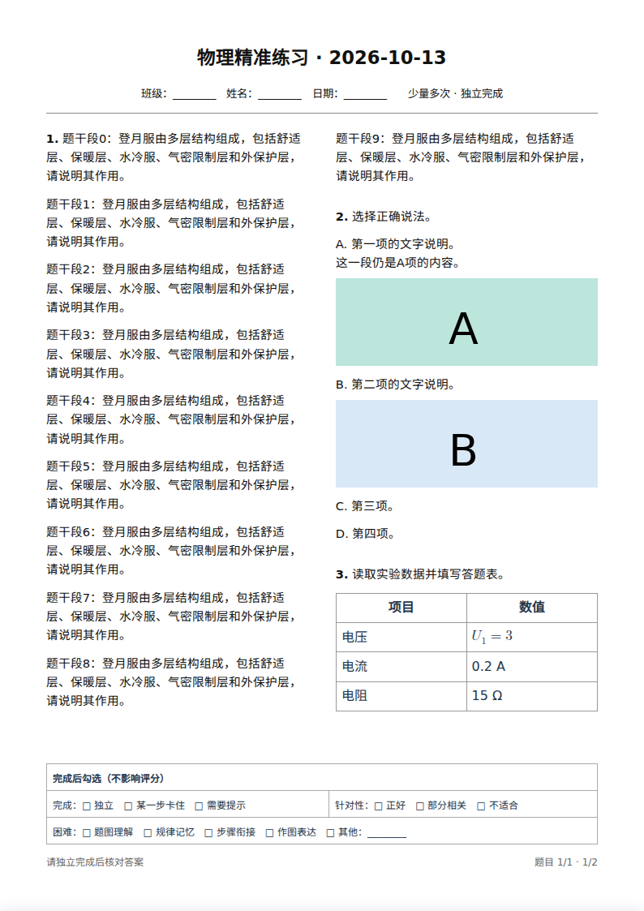
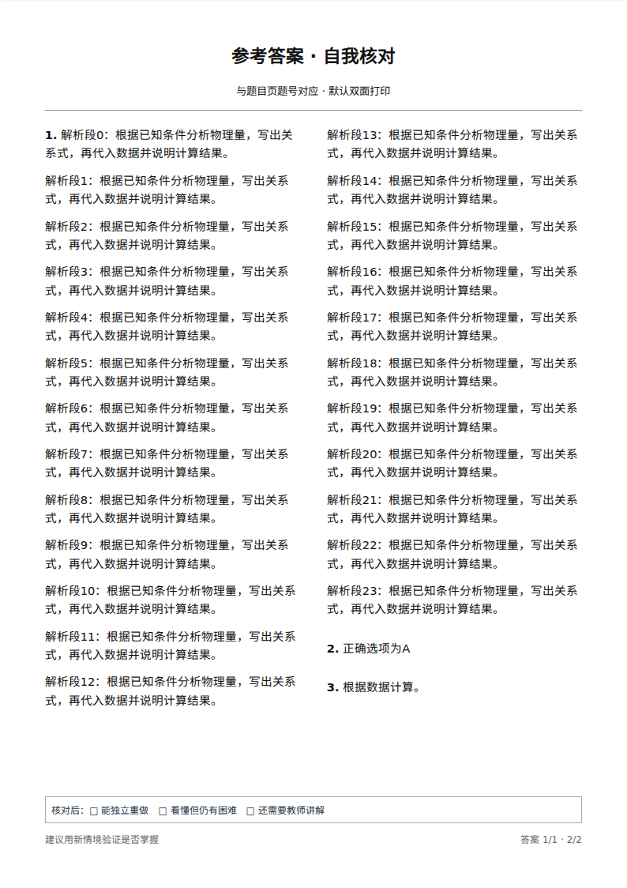

# 题库第三阶段：连续双栏预览与完整续页

范围：`zmdyy/xqfx-zsxq-tk` 的浏览器打印预览。第一、二阶段的编辑器布局、疑点定位与批量修改保持可用。

## 已完成

- 按题目顺序从左栏接到右栏，再接下一页，取消第 1、3 题固定左栏、第 2、4 题固定右栏的规则。最后一页在内容块边界适当平衡两栏。
- 题干和答案按段落分块；一题可以跨栏、跨页。换行位于公式内部时，不会把公式拆断。
- 单个选项的文字、后续说明及明确归属该选项的配图作为整体移动。可以在 A 与 B 选项之间换栏；图片和答题表整体保留。
- 使用已有 `optionLabel` 或 `optionImageIndexes` 关联图片。没有明确归属的图片仍留在本题中；仅有 A–D 空标签和配图时保留整个选项图组，不依据图片顺序猜测选项归属。
- 按 A4 210 × 297 mm、上下 14 mm、左右 15 mm 边距测量。等待图片解码及字体就绪后分页，给反馈表和页脚留出空间。
- 题目与答案超过一页时完整显示续页，显示各自页数和全卷页码。预览不再隐藏溢出内容。
- 不可拆分的内容本身超过一页高度时，预览加高并明确提示“此处不可拆分内容超过一页高度，已完整显示，请检查打印效果”。这种加高预览不表示该表已能原样放在一张 A4 上。
- 自动版式先检查单栏，再比较双栏；手动选择单栏或双栏时保持选择。提示给出实际题目和答案页数。

## 验证

`npm test`、`npm run test:preview`、`npm run test:editor` 均通过。浏览器测试使用 Chromium headless shell；样例为测试构造的数据，未替换用户的正式题库。

| 场景 | 验收结果 |
| --- | --- |
| 四道短题双栏 | 左栏 1、2，右栏 3、4，连续阅读 |
| 十段长题、配图选项、实验表 | 长题跨栏，整卷题目一页、答案一页，所有内容均位于列范围内 |
| 打乱图片顺序并明确 A/B 归属 | 选项仍显示正确配图，A 项的多段说明保持完整 |
| 自动选择版式 | 单栏放不下时选择可容纳内容的双栏 |
| 九十段题干、八十段答案 | 分别完整续页，逐段检查顺序，无遗漏、重复，页码正确 |
| 六十六行不可拆分答题表 | 所有行完整显示，加高提示可见，表格与页脚不重叠 |
| 前两阶段编辑器 | 独立滚动、持续高亮、68 处同类修改、撤销、保存和再次打开均回归通过 |

以下为脱离弹窗滚动容器捕获的完整预览页，仅用于展示排版：

## 后续阶段

第四阶段仍需修改 Word 导出：采用原生连续双栏，保持图片、单个选项和表格的分页约束，并取消超出 A4 时阻止导出的规则，改为提示后允许导出。本阶段仍保留原 Word 导出器及其超出拦截，因此 Word 排版尚不等同于本次浏览器预览。

第五阶段处理 `#review` 全网页审核、隐藏主页内容和浏览器后退返回主页。
