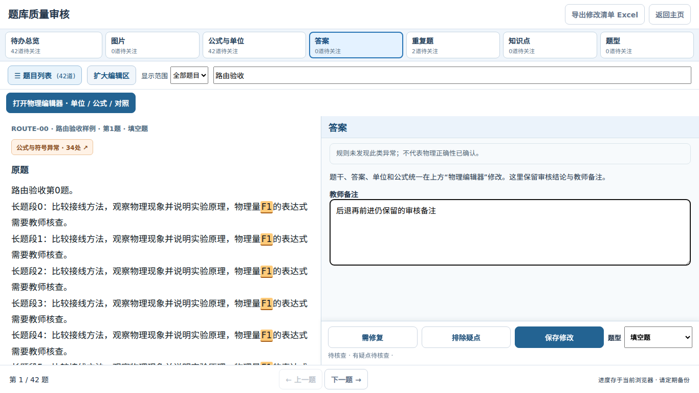

# 题库第五阶段：全网页审核与历史导航

范围仅限 `zmdyy/xqfx-zsxq-tk` 的题库页。审核页面占满浏览器的网页可用区域，不调用浏览器全屏。

## 已完成

- 点击「题库质量审核」后，隐藏主页的顶部栏、筛选区、题目资源和试题篮，地址变为 `#review`。
- 审核视图贴合网页四边，不再受原弹窗的最大宽度、最大高度和外边距限制。标题、维度、筛选、操作按钮和上一题/下一题均保留。
- 审核使用独立视图；物理编辑器、图片对照等仍通过原有模态窗口打开。主页隐藏后同时禁止其获得键盘焦点。
- 从主页进入后，浏览器后退返回主页，前进再次进入审核。「返回主页」使用原有历史记录，不额外增加一条主页记录。
- 直接打开 `#review`、刷新审核页以及空题库均可正常使用。直接打开审核时，返回按钮留在当前题库页面，保留查询参数。
- 返回主页恢复页面标题、原有搜索条件、试题篮、题目列表内部滚动位置和网页滚动位置。同一页面内后退/前进还保留当前审核维度、显示范围、搜索和未提交备注。
- Escape 优先收起题目列表或放大的题图；否则返回主页。打开物理编辑器等模态窗口时，Escape 由该窗口处理。
- 浏览器后退时，先等待物理编辑器已有草稿写入完成，再关闭编辑器和附属对照窗口；不将草稿自动保存为正式题目。编辑器忙或拒绝关闭时，保持编辑器和审核页。
- 从主页编辑器前进到审核时，先完成编辑器关闭，避免把它的滚动锁带回主页。待选择学生的导出弹窗保留自己的工作流程。
- 导航处理串行执行，并合并重复的返回请求，防止一次历史导航同时触发多个事件而多退一页。已重新打开的窗口忽略之前延迟触发的关闭事件。
- 修正审核顶部「打开物理编辑器」工具条未扣除高度的问题；短屏采用紧凑工具栏，重复题结论区可内部滚动，避免操作被页底挤出。

## 验证

`npm test`、`npm run test:review`、`npm run test:editor`、`npm run test:preview` 和 `npm run test:word` 均通过。

新路由测试使用中文字体及独立测试题库，检查 1920×1080、1366×768、390×844、390×620 和 844×390 五种网页尺寸。

| 场景 | 验收结果 |
| --- | --- |
| 进入审核 | `#review` 正确，主页隐藏且不可获得焦点，审核四边贴合网页，未调用全屏 |
| 后退、前进、返回按钮 | 页面及审核正常切换，查询参数与原有主页锚点保持，未增加多余主页记录 |
| 快速历史导航 | 最终地址、显示状态一致，无旧关闭事件误退出新界面 |
| 搜索、试题篮和滚动 | 返回主页后搜索条件、两道已选题及内外滚动位置恢复 |
| 审核备注 | 同一页面内后退、前进后仍保留未提交备注、维度、范围及搜索 |
| 编辑器草稿 | 后退后再次打开编辑器，未正式保存的草稿仍在；主页滚动正常解锁 |
| 嵌套窗口与关闭拒绝 | 图片对照窗口正常清理；编辑器拒绝关闭时仍留在审核页 |
| 手机与横屏 | 操作按钮不压入页脚；重复题结论可滚动到操作按钮 |
| 直接链接与刷新 | 可直接进入审核，空题库显示空状态，返回按钮保留本页及查询参数 |
| 原有审核 | 疑点选中、重复题结论持久化、图片哈希迁移及 ZIP 更新保持通过 |
| 前四阶段功能 | 物理编辑器独立滚动、68 处同类修改、连续预览及超出仍可导出 Word 回归通过 |

下图来自测试构造的数据，不是用户正式题库。

## 使用边界

未提交审核备注的保留针对同一页面内的后退、前进；刷新会重新读取题库，备注仍须点击「保存修改」。物理编辑器已有独立的本地草稿机制，保持不变。

测试不修改用户正式题库，不需要重新导入题库。浏览器预览与 Word 的换栏位置仍可能受字体和排版引擎影响；本身超高的选项或表格仍按第四阶段的提示处理。

## 五阶段完成情况

| 阶段 | 完成内容 |
| --- | --- |
| 第一阶段 | 物理编辑器左侧编辑、右侧操作，独立滚动和完整显示 |
| 第二阶段 | 准确定位、持续高亮、一键本题同类修改与上下标/撇号保护 |
| 第三阶段 | 浏览器连续双栏、分块换栏、完整续页及实际页数 |
| 第四阶段 | Word 原生连续双栏、原生公式、超出 A4 提示后仍可导出 |
| 第五阶段 | 全网页审核、`#review`、后退返回主页及滚动恢复 |
